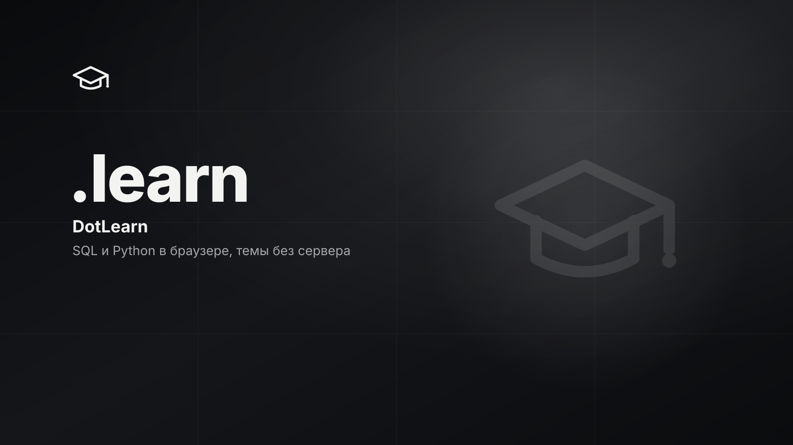

# .learn

<p>
  
  
  
  <!-- loc:start --><!-- loc:end -->
</p>



Local-first монорепо: тема - модуль из MDX и YAML под Zod, а не статическая страница. SQL и Python считаются в браузере (sql.js, Pyodide, Web Workers); `apps/web` открывается без `apps/api`. Контент тем собирается офлайн скиллом `lesson-forge`, в рантайме AI нет.

## Что внутри

- **Темы**: 64 каталога с `manifest.json` под `topics/` (так считает `loadTopics` и валидатор). 416 концептов в манифестах. Английское издание у 46 тем, остальные только ru.
- **Каталог**: 11 разделов в `catalog-categories.data.json`, 6 треков в `tracks.data.json`, глоссарий на 148 терминов.
- **Упражнения**: 9 вариантов `Exercise` (`z.discriminatedUnion('type')` в `packages/contracts`): `theory-quiz`, `sql-query`, `python-function`, `javascript-function`, `fill-in-blanks`, `predict-output`, `git-challenge`, `onec-lab`, `onec-designer`.
- **1С**: одна страница `/onec` и один пункт меню «1С». Прямые окна: `/workbench` (учёт товаров, тип `onec-lab`, тема `onec-workbench`), `/plant` (учёт завода, тип `onec-designer`, тема `plant-case`), `/clinic` (база клиники; в трек `onec` не входит).
- **Собеседования**: 1455 вопросов в `interview/index.json`, страницы ru и en, хаб `/interview`.
- **Рантайм в браузере**: Monaco, sql.js и Pyodide в Web Workers. Отдельная песочница `/sandbox`. Визуализации теории: 54 имени в `VIZ_NAMES` пререндера.
- **Повторение и прогресс**: флэшкарды на `ts-fsrs`, прогресс в IndexedDB (Dexie), лестница повторного экзамена 1, 3, 7, 16 и 35 дней, калибровка ответов по Брайеру. Экспорт прогресса включает заметки и закладки. Кросс-девайс синк по коду: blob на api, merge на клиенте.
- **Онлайн**: анонимный presence. При `PRESENCE_ANALYTICS` считаются уникальные (HyperLogLog), окна 7 и 30 дней, разбивка по темам и страница `/analytics`.
- **Интерфейс**: палитра Ctrl/Cmd+K, нижняя панель на узком экране, PWA (`vite-plugin-pwa`), анимации `framer-motion`, конфетти при решении.
- **Пререндер**: 3032 HTML. Состав: 64 ru-темы, 46 en-тем, главная ru+en, глоссарий ru+en, 1455 вопросов на двух языках, хаб interview ru+en, хабы `flashcards`, `tracks`, `map`, `sandbox`, `onec`, страница 404. Хаб `onec` есть в `prerender.mjs` и в `HUB_ORDER` (`seo-artifacts.mjs`). `workbox.globIgnores` содержит `onec/**`.
- **Языки**: русский основной, английский вторичный. UI и банк вопросов двуязычные. Тема без en с `/en/topics/<slug>` уходит на ru.

## Запуск

```bash
pnpm install
pnpm dev:web
```

http://localhost:5173. Node.js 22+, pnpm 11 (`package.json`: `node >=22`, `pnpm >=11`, `packageManager` `pnpm@11.13.1`).

Новая тема:

```
Используй lesson-forge, добавь тему по SQL JOINs
```

Скилл: `.cursor/skills/lesson-forge/`, зеркало `.claude/skills/lesson-forge/`.

`pnpm dev:api` поднимает NestJS на порту 3000 (`HOST` по умолчанию `127.0.0.1`). Вне production Swagger на `/docs`. Префикс API: `/api`.

### Docker

```bash
docker compose up --build -d
```

Нужна внешняя сеть `dotsound` (имя: `DOTSOUND_NETWORK`, иначе `dotsoundbackend_dotsound`). Контейнер `web` слушает 8080 и наружу порт не публикует. API на хосте: `127.0.0.1:3000` (`API_PORT`). Elasticsearch только с профилем `search`, порт `127.0.0.1:9200` (`ES_PORT`). Поиск заявок in-memory, пока `ES_ENABLED` не `true`.

Прод-образы (сервер не собирает):

```bash
docker compose -f docker-compose.yml -f docker-compose.prod.yml pull
docker compose -f docker-compose.yml -f docker-compose.prod.yml up -d --no-build
```

`GHCR_OWNER` задаёт `ghcr.io/<owner>/dotlearn-web` и `dotlearn-api`. В этом overlay `TRUSTED_PROXY_HOPS` по умолчанию `2` (Caddy и nginx). В базовом compose дефолт `1`.

Bare-metal, без Docker: `sudo bash scripts/deploy.sh`. Короткие цели: `make deploy`, `make update`, `make status`, `make logs`, `make logs-web`, `make restart`, `make backup`, `make restore FILE=...`. Подробности: [docs/SELF_HOSTING.md](docs/SELF_HOSTING.md).

## Команды

| Команда                             | Назначение                             |
| ----------------------------------- | -------------------------------------- |
| `pnpm dev:web`                      | Vite SPA                               |
| `pnpm dev:api`                      | NestJS API                             |
| `pnpm dev`                          | web и api параллельно (Turborepo)      |
| `pnpm build`                        | сборка; у web ещё пререндер и OG       |
| `pnpm typecheck`                    | TypeScript по монорепо                 |
| `pnpm test`                         | vitest                                 |
| `pnpm validate`                     | Zod-контракт тем и gold-решения        |
| `pnpm lint` / `pnpm lint:fix`       | ESLint                                 |
| `pnpm format` / `pnpm format:check` | Prettier                               |
| `pnpm check:i18n`                   | паритет ключей ru/en                   |
| `pnpm check:bundle`                 | бюджет eager-JS после build            |
| `pnpm check:headers`                | CSP: vite, nginx, Caddy                |
| `pnpm sync:skills`                  | `.cursor/skills/` в `.claude/skills/`  |
| `pnpm check:skills`                 | зеркала скиллов совпадают              |
| `pnpm audit:prod`                   | `pnpm audit --prod --audit-level high` |
| `pnpm check:interview`              | проверка банка interview               |
| `pnpm validate:interview-exercises` | упражнения interview                   |
| `pnpm build:interview-index`        | `interview/index.json`                 |
| `pnpm build:interview-flashcards`   | флэшкарты interview                    |

Ещё в корневом `package.json`: `import:interview`, `reorg:interview`, `verify:interview-py`.

## Стек

<p>
  
  
  
  
  
  
  
  
  
  
  
  
  
  
</p>

## Тесты

```bash
pnpm typecheck
pnpm validate
pnpm test
```

CI (`.github/workflows/ci.yml`, Node 22): `check:skills`, `check:headers`, `check:i18n`, `format:check`, `typecheck`, `lint`, `test`, `validate`, `audit:prod`, `build`, `check:bundle`.

## Архитектура

pnpm workspaces и Turborepo. `apps/web` и `apps/api` друг из друга не импортируют. Общие типы только в `packages/contracts`. Web читает `topics/` через Vite `import.meta.glob`, sandbox крутится в Web Workers и живёт без API и без AI. API опционален: заявки, admin, поиск (in-memory или Elasticsearch), presence, sync. Сборка web дописывает пререндер, sitemap, robots, llms, markdown-зеркала и OG; в eager-бандл и в прекэш service worker это не входит.

```
.learn/
├── apps/
│   ├── web/                  # Vite + React, local-first; /onec, /workbench, /plant, /clinic
│   └── api/                  # NestJS: submissions, admin, search, presence, sync
├── packages/
│   ├── contracts/            # Zod, в том числе 9 типов Exercise
│   ├── lesson-engine/        # загрузчик тем, раннеры, CLI-валидатор
│   └── sandbox/              # sql.js + Pyodide в Web Workers
├── topics/                   # 64 темы (46 с en)
├── interview/                # 1455 вопросов (index.json) + exercises
├── deploy/                   # Caddyfile + systemd
├── scripts/                  # deploy.sh, проверки, контент-тулинг
├── .cursor/skills/           # lesson-forge, generate-readme, sync-project-rules
├── .claude/skills/           # зеркало (pnpm sync:skills)
├── docker-compose.yml
└── AGENTS.md
```

- **Local-first**: `apps/web` работает без `apps/api`.
- **Pure-logic**: в рантайме нет AI. LLM только офлайн, через `lesson-forge`.
- **contracts**: единственный общий слой web и api. Схемы задаёт Zod.
- **topics**: не импортируют из `apps/*`.
- **Один вход 1С**: меню ведёт на `/onec`. `/workbench`, `/plant` и `/clinic` остаются прямыми маршрутами, отдельных пунктов нет.
- **SEO build-time**: пререндер и артефакты, включая `onec/**`, не попадают в SW-прекэш (`workbox.globIgnores`).

## Лицензия

© 2026 DotCore. [PolyForm Noncommercial 1.0.0](LICENSE).

Разрешены форки, изменения и распространение в некоммерческих целях. Учебный контент тем (`topics/`) лицензирован по [CC BY-NC 4.0](https://creativecommons.org/licenses/by-nc/4.0/). Коммерческое использование в любом виде требует предварительного письменного разрешения автора. См. [LICENSE](LICENSE).
